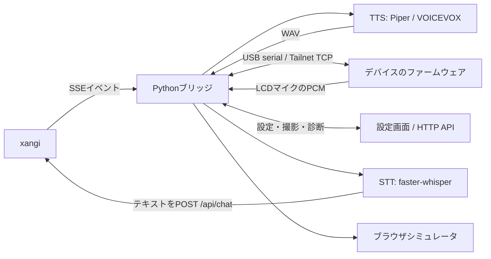

# 設計

操作手順は[使い方](usage.md)、転送フォーマットは[ブリッジプロトコル](xangi_bridge_protocol.md)を参照。

## 全体構成

xangiがAIの会話とツール実行を担当し、ブリッジがイベントを表情・首振り・音声へ変換する。デバイスのファームウェアはLCD・スピーカー・マイク・サーボ・カメラ・LEDを制御する。

## 主な実装

| 実装 | 役割 |
|---|---|
| `src/xangi_stackchan/app.py` | CLI、SSE購読、状態遷移、顔アニメーション、接続の再初期化 |
| `events.py` / `completion.py` | イベント解釈、完了通知の判定と要約 |
| `stackchan.py` / `serial_actor.py` | USB・Tailnet・シミュレータの通信、シリアル入出力の管理 |
| `sprite_face.py` | スプライト画像の切り出しとJPEG化 |
| `tts.py` / `stt.py` / `voice_conversation.py` | 音声合成、文字起こし、録音から会話への投入 |
| `settings.py` / `settings_server.py` | 設定の保存、実行中の再適用、HTTP APIと設定画面 |
| `extension.py` | xangi Managed Extensionの起動と認証 |
| `firmware/examples/<machine>/main/` | 機種別の実機制御 |

Pythonのファイル名は、明記がないものも`src/xangi_stackchan/`内。

## イベントと状態

- 思考中: `doubt`の顔と首かしげ。
- 発話中: `happy`の顔、TTS音声の再生と小さな首振り。
- 完了後: `neutral`の顔と待機姿勢。
- エラー: `sad`の顔と首下げ。

これらの表情・姿勢は設定で変更できる。通常応答の読み上げと長時間作業の完了通知は個別に有効化できる。Managed起動の初期値は通常応答・LCDマイク・ファーム内蔵なで音声をOFF、完了通知をONとする。保存済み設定があればそれを使う。

`thread_id`や発話対象platformによって対象イベントを絞る。複数台運用は1プロセスにつき1台で、設定は`instances.<id>`に分離する。

## 接続方式

### USB

`StackchanSerial`が改行区切りのコマンドとバイナリを送受信する。`SerialActor`が入力を処理し、応答とマイクなどの非同期イベントを振り分ける。同じデバイスを複数プロセスで使わないためのロックを持つ。

### Wi-Fi・Tailnet

`cores3-main-tailnet`は通常のCoreS3ファームにMicroLinkを加えた実験構成。CoreS3からTailnet内のホストへTCP接続し、`StackchanTailnet`が受け付ける。protocol v3ではUSBと同系統のコマンドとバイナリ転送を扱い、WAV・マイクPCM・画像顔・スプライトキャッシュ・差分矩形・カメラJPEGに対応する。

Wi-FiとTailnetの初期認証情報はGit管理外の`tailnet_secrets.h`に置く。登録後のmachine/WireGuard keyはMicroLinkがNVSへ保存する。USB経路も残るが、同じ実機へ複数ブリッジから同時操作する構成を前提にしない。

### シミュレータ

`StackchanSimulator`は実機へ接続せず、同じイベント処理の出力をメモリ内の状態へ反映する。`/simulator`で顔・首角度・ライト・発話を確認する用途で、ハードウェアの物理特性や通信品質を検証するものではない。

## 顔の描画

`avatar`は`FACE:<expr>`でファーム内のM5Stack Avatarを制御する。`sprite`はホストの画像をJPEGへ変換して送る。既定は`sprite`で、シート未配置・画像送信非対応時は`avatar`へ戻り、理由をログに残す。

スプライトシートは192×208ピクセルのセルを8列×9行に並べる。行番号は0から数え、neutralは0、happyは3、sad/angryは5、sleepyは6、doubt/listeningは8を使う。各行の画像があるフレームを使ってアニメーションする。対応関係は`sprite_face.py`の`EXPRESSION_TO_ROW`で管理する。

CoreS3では`SIMG`でJPEGをPSRAMへキャッシュし、`SFRAME`で表示を切り替える経路や差分矩形転送を使って転送量を抑える。画像本体は`assets/pets/<name>/spritesheet.webp`へローカル配置し、リポジトリへ含めない。バッテリー残量はファーム側で顔の上に表示する。

## 音声・カメラ・ハードウェア差

Piperは常駐プロセスを再利用してモデル再ロードを避ける。録音中はマイクとスピーカーのI2S共有に合わせて切り替える。LCDマイク入力はPCM録音、STT、xangiへのテキスト送信、SSE経由の応答再生という往復になる。

カメラはCoreS3で1要求につきJPEGを1枚取得する。要求より古いDMAフレームを除外して撮影する。常時動画配信やLLMへの画像自動添付は行わない。

サーボ・カメラ・LEDなどの有無は`STATUS`から判定する。未搭載機では該当機能を無効化し、使える機能は継続する。例えばCoreS3単体は首振りを使えないが、顔・音声・撮影は使える。

## 設定と診断

CLI・既定値を基に保存済み設定を適用し、Managed起動ではxangiからイベントURL・instance ID・認証情報を受け取る。設定画面はxangiの認証付きプロキシ経由で開く。

`/api/health`はサービス稼働と実機接続を分け、`service_running`、`device_connected`、`transport`、`ready`を返す。`/api/device/status`はファームの状態を返す。設定の`face_mode`は希望する表示方式であり、実際の画像表示状態は`image_face`とログで確認する。

## 参考

- [m5stack/StackChan](https://github.com/m5stack/StackChan): 公式K151の仕様参照元
- [stack-chan/stack-chan](https://github.com/stack-chan/stack-chan): サーボ制御の仕様参照元
